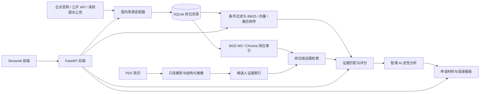

# AI Job Apply Assistant

[](https://www.python.org/)
[](https://fastapi.tiangolo.com/)
[](#测试与验证)
[](LICENSE)

一个方便应聘者使用的 Agent 求职辅助系统，整合岗位发现、简历匹配、申请材料生成和投递记录管理，形成可追踪的求职工作流。

## 核心能力

- 岗位聚合：统一接入企业招聘官网、公开招聘接口和高校就业公告等合规公开来源。
- 一键更新：前端点击一次即可执行“岗位同步 → 去重入库 → 岗位索引重建”，无需常驻自动任务。
- PDF 简历解析：逐页提取文字，对扫描页、乱码或碎片化文字自动执行本地 OCR，保存页码与提取方式，再构建结构化画像和候选人证据索引。
- 可解释岗位匹配：结合硬性条件、技能覆盖、项目证据和风险项给出分项评分及引用依据。
- 岗位级 RAG：使用 BGE-M3 与 Chroma 检索候选人证据和岗位证据。
- 全库岗位发现：支持结构化条件过滤后的 BM25、向量检索及 RRF 融合；UI 默认 BM25，可切换策略。
- Agent 工具调用：通过 LangChain 编排岗位搜索、匹配分析和申请材料生成工具。

## 系统架构



前端“一键更新”的执行链路为：

```text
点击更新 → 拉取已启用来源 → 标准化与去重 → 写入 SQLite → 重建岗位索引 → 返回同步统计
```

## 技术栈

| 层次 | 主要技术 |
|---|---|
| 前端 | Streamlit |
| API | FastAPI、Pydantic |
| LLM 与编排 | 智谱 AI、LangChain 1.4.0（create_agent / LangGraph） |
| 检索 | BGE-M3、Chroma |
| 数据 | SQLite、CSV、JSON |
| 测试与部署 | Pytest、Docker Compose |

## 检索指标

已补测全库搜索 Top5 指标：M3 融合在18个有相关岗位测试题上 Precision@5=0.4889、Hit@5=0.9444（17/18）、nDCG@5=0.7819；同模型纯向量分别为0.3222/0.8333/0.6045。固定分母 Precision、全部20题结果及局限见 [Top5 补充评测](docs/domestic-discovery-top5.md)。Hit不等于推荐准确率，数据仍为自建条件银标回归集。

2026-09-21 已将评测拆为全库岗位发现、指定岗位证据定位和资料缺失识别。
冻结 267 个去重国内具体岗位、972 个生产切块、30 个搜索意图和 80 个证据问题。
以下是搜索测试中 18 个有相关岗位问题的结果，另 2 个无相关岗位问题单独保留。

| 配置 | MRR@10 | Recall@20 | nDCG@10 |
|---|---:|---:|---:|
| 随机排序理论值 | 0.1922 | 0.2958 | 0.2490 |
| BM25 | 0.7539 | 0.7439 | 0.7035 |
| BGE-small-zh-v1.5，纯向量 | 0.7824 | 0.7052 | 0.6694 |
| BGE-M3，纯向量 | 0.6765 | 0.6562 | 0.6133 |
| small + BM25 融合 | 0.8065 | 0.7831 | 0.7867 |
| M3 + BM25 融合 | 0.8385 | 0.7658 | 0.7658 |

M3 融合对比同模型纯向量，nDCG@10 相对 +24.88%，Recall@20 增加 10.96 个百分点；
这是策略改进，不是更换 embedding 的收益。单岗证据测试 24 个有答案题上，
small/M3 的 MRR@3 为 0.8750/0.8889（+1.59%，区间跨零），Recall@2 均为 0.9583。
M3 没有全面胜出；BM25 在该单岗任务的 MRR 更高，small 融合在全库部分指标更好。

原同岗证据口径已补齐 **MRR@3 / Recall@5**，固定同一份岗位、切块、问题与标签，实际检索 Top5：

| 同岗证据配置 | MRR@3 | Recall@5 |
|---|---:|---:|
| BGE-small-zh-v1.5，512 | 0.8750 | 1.0000 |
| BGE-M3，512 | 0.8889 | 1.0000 |
| BGE-M3，1024 | 0.8889 | 1.0000 |
| 随机排列理论值 | 0.6019 | 1.0000 |

此表为 8 个测试岗位、24 个有答案题；各题候选池仅 2—4 个切块，因此 Recall@5 饱和，不表示模型全面优越。
它与上方岗位级搜索是不同任务。完整控制条件、基线和区间见[同岗证据对照](docs/domestic-same-job-evaluation.md)。

**这些是约束银标与助手原文引文标签，非人工金标或盲测。** 标签审计后保留旧版并重新评测。
相似度拒答阈值仍误放行 18.75% 无答案题、误拒绝 50% 有答案题，未启用为生产自动回答开关。
完整数据口径、失败原因、人工复核入口和复现命令见[业务评测报告](docs/domestic-business-evaluation.md)。
旧主题模板集接近满分的 Recall 及英文历史 JD 的 0.7614/0.8750 仅留作[历史实验](docs/domestic-retrieval-evaluation.md)，
不能替代当前业务评测，更不是岗位匹配准确率或面试通过率。

国内页面已支持 PDF 上传、岗位搜索、证据检索、匹配分析、申请材料草稿、历史回读与投递看板。
项目适合个人使用和面试展示；正式库已同步 297 条国内招聘记录（269 个具体岗位、28 个公告合集），
重建 1,190 个 BGE-M3 片段，数据与索引就绪检查通过；尚不是通过公网多用户验收的产品。
详见[上线评估与操作说明](docs/domestic-release-readiness.md)和[简历与 STAR 介绍](docs/domestic-resume-star.md)。

## 快速开始

运行环境要求 Python 3.10 或以上。本项目已从 LangChain 0.3.25 迁移到 1.4.0，
请安装完整的 `requirements.txt`，不要只升级 `langchain` 单个包。
接口变化、验证范围和维护事项见 [LangChain 1.x 迁移说明](docs/langchain-v1-migration.md)。

### 1. 创建环境并安装依赖

Linux / macOS：

```bash
python3.10 -m venv .venv
source .venv/bin/activate
python -m pip install --upgrade pip
python -m pip install -r requirements.txt -r requirements-dev.txt
```

Windows PowerShell：

```powershell
python -m venv .venv
.\.venv\Scripts\Activate.ps1
python -m pip install --upgrade pip
python -m pip install -r requirements.txt -r requirements-dev.txt
```

### 2. 配置环境变量

Linux / macOS：

```bash
cp .env.example .env
```

Windows PowerShell：

```powershell
Copy-Item .env.example .env
```

离线演示无需 API Key，保留以下安全配置即可：

```dotenv
ZAI_API_KEY=
EMBEDDING_BACKEND=hash
ENABLE_RERANKER=false
DOMESTIC_SYNC_ENABLED=false
```

需要大模型分析时，在本机 `.env` 中填写 API Key。
需要 BGE-M3 时，将嵌入后端改为 Hugging Face，并按机器条件配置本地模型目录或模型名称。

实际使用时可以直接启动服务，在前端设置当前 `candidate_id`、毕业年份、目标岗位和目标城市，上传文字版、扫描版或混合 PDF 简历，然后点击“一键更新岗位”。个人简历、模型密钥、投递记录和本地索引均不会进入版本库。

简历 OCR 使用随依赖安装的 RapidOCR 中英文 ONNX 模型和 PDFium，在本地 CPU 上按需执行，不将 PDF 发往外部 OCR 服务。默认最多 20 页、200 DPI、每页最多 1200 万像素；文字质量合格的页面不启动 OCR。空白页保留页码但不入库，无法识别的非空页面会阻止导入，避免漏掉经历后仍显示成功。原始 PDF 不改写；`extraction_report.json` 保存逐页原始提取文字、最终文字、OCR 文本框及置信度，向量切块保留页码与提取方式。界面显示 OCR 页码与复核提示。质量检测是启发式检查，不能保证发现所有漏字或多栏顺序错误；扫描简历尤其需要核对日期、数字和联系方式。

### 3. 启动服务

终端 1：

```bash
python -m uvicorn app.main:app --host 0.0.0.0 --port 8000
```

终端 2：

```bash
python -m streamlit run streamlit_app.py --server.port 8501
```

浏览器访问 `http://127.0.0.1:8501`。API 文档位于 `http://127.0.0.1:8000/docs`。

## Docker Compose

```bash
cp .env.docker.example .env.docker
# 填写 API_TOKEN（至少 32 字符）、智谱密钥，准备 models/bge-m3/。
docker compose up --build
```

Windows PowerShell 将第一行替换为：

```powershell
Copy-Item .env.docker.example .env.docker
```

Compose 使用独立的容器配置和模型只读挂载，默认 CPU、仅监听本机。
可通过 MODEL_DIR 环境变量指定宿主机模型父目录。容器实机启动尚未验收；
索引初始化、健康检查与维护流程见[部署说明](docs/domestic-release-readiness.md)。
启动后访问前端 `http://127.0.0.1:8501`。停止服务：

```bash
docker compose down
```

## 岗位来源

优先使用企业招聘官网、明确公开的 JSON 接口和高校就业公告。

来源适配器支持独立启停、频率控制、失败隔离和字段标准化。公开页面结构变化时，对应适配器可能需要维护。

## 测试与验证

```bash
python -m pytest -q
python -m tools.evaluate_retrieval_v2
```

## 项目局限

- 岗位来源受公开页面稳定性和网站使用条款影响，无法保证覆盖全部公司或持续实时更新。
- 规则评分和 LLM 输出只能作为求职决策辅助，不能替代人工判断。
- Agent 与知识问答会话已支持最近窗口、滚动摘要、输入预算和工具结果引用；尚未实现跨会话长期记忆。

## 项目结构

```text
app/                    FastAPI、领域逻辑与来源适配器
streamlit_app.py         Streamlit 前端
data/demo/              完全合成的示例数据
data/eval_dataset/      可复现实验数据与报告
docs/                   架构、截图和说明
tests/                  自动化测试
tools/                  数据导入、评测和示例生成工具
compose.yaml            本地容器编排
```

## 许可证

本项目采用 [MIT License](LICENSE)。
